# DARINet

**Plant disease identification with a dual self-attention modified residual-inception network.**

[](https://github.com/RashiChauhan67/DARINet/actions/workflows/ci.yml)
[](LICENSE)


> **Paper.** R. Chauhan, M. Karnati, M. K. Dutta, R. Burget. *Plant Disease Identification Using a Dual Self-Attention Modified Residual-Inception Network.* 2023 15th International Congress on Ultra Modern Telecommunications and Control Systems and Workshops (**ICUMT**), IEEE, 2023. DOI: [10.1109/ICUMT61075.2023.10333302](https://doi.org/10.1109/ICUMT61075.2023.10333302)

[Overview](#overview) · [Architecture](#architecture) · [Quick start](#quick-start) · [Datasets](#datasets) · [Results](#results) · [Notes](#notes) · [Citation](#citation)

## Overview

DARINet is a compact CNN (about 0.65 M parameters) for classifying leaf images by disease. It combines a **modified inception block** (depthwise-separable convolutions), a residual connection, and two attention modules, **channel** and **spatial**, whose outputs are summed with the features. The network is identical across datasets; only the output layer changes.

This repository has a cleaned, tested Keras 3 implementation, the original experiment notebooks, and the recorded results.

| | Cassava | Rice | Maize |
|---|---|---|---|
| Classes | 5 | 3 | 4 |
| Test images | 590 | 48 | 421 |
| Test accuracy | **77%** | **97.9%** | **94%** |
| Macro F1 | 0.71 | 0.97 | 0.92 |
| Parameters | 648,390 | 648,132 | 648,261 |

Accuracies are the values recorded in the notebooks.

## Architecture

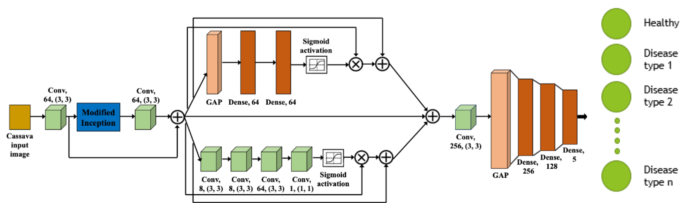

## Quick start

```bash
git clone https://github.com/RashiChauhan67/DARINet.git
cd DARINet
python -m venv .venv && source .venv/bin/activate
pip install -e .
```

Train and evaluate:

```bash
# Original protocol (single train/test split)
python scripts/train.py --data-dir /path/to/cassava-disease/train --dataset cassava \
    --output-dir runs/cassava

# Holdout protocol: validation is taken from the training data; the test set is used once
python scripts/train.py --data-dir /path/to/rice_leaf_diseases --dataset rice \
    --protocol holdout --output-dir runs/rice_holdout

# Evaluate a saved model on the regenerated test split
python scripts/evaluate.py --data-dir /path/to/rice_leaf_diseases --dataset rice \
    --model runs/rice_holdout/best_model.keras
```

Defaults: Adam (Keras default 1e-3), batch size 16, up to 100 epochs, early stopping on validation loss (patience 10 for Cassava, 20 for Rice and Maize, best weights restored). Each run writes `best_model.keras`, `history.json` and `metrics.json`.

Use the model directly:

```python
from darinet.model import build_darinet, compile_model

model = compile_model(build_darinet(num_classes=5))  # 648,390 parameters
```

## Datasets

| Key | Dataset | Classes | Images | Test split |
|---|---|---|---|---|
| `cassava` | Cassava leaf disease | cbb, cbsd, cgm, cmd, healthy | 5,894 | 10% (590) |
| `rice` | Rice leaf diseases | bacterial leaf blight, brown spot, leaf smut | 120 originals | 10% (48) |
| `maize` | Maize leaf disease | blight, common rust, gray leaf spot, healthy | not recorded | 10% (421) |

Data is not included; see [`data/README.md`](data/README.md) for the expected folder layout (class folders `0`, `1`, ...), sources and citations. Images are resized to 128 x 128, scaled to [0, 1] and read with OpenCV.

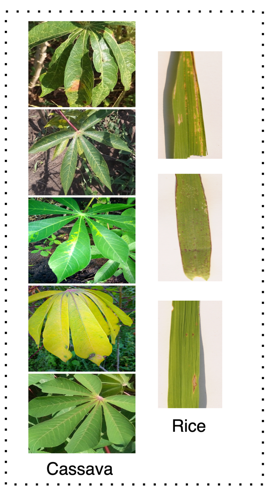

## Results

Results from the original experiment notebooks. Per-class tables are in [`results/recorded_results.md`](results/recorded_results.md).

Cassava is the hardest dataset: the weakest class is `cbb` (precision 0.43, recall 0.51) and the strongest is `cmd` (recall 0.90). Maize's weakest class is gray leaf spot (recall 0.70).

### Cassava

| Confusion matrix | ROC curves |
|---|---|
| 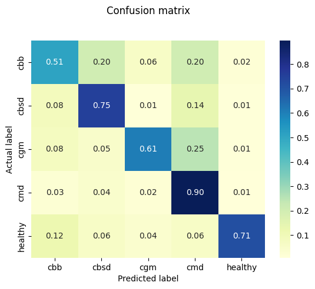 | 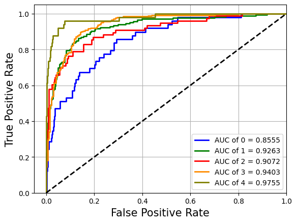 |
| 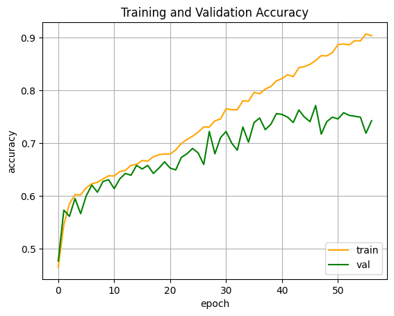 | 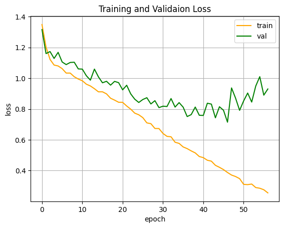 |

Interpretability examples from the notebook:

| LIME | Grad-CAM |
|---|---|
| 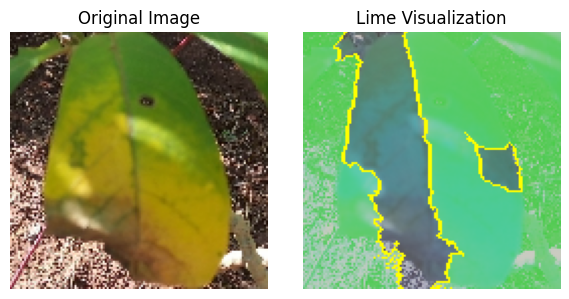 | 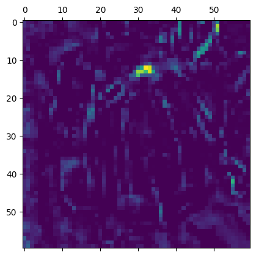 |

### Rice

| Confusion matrix | ROC curves |
|---|---|
| 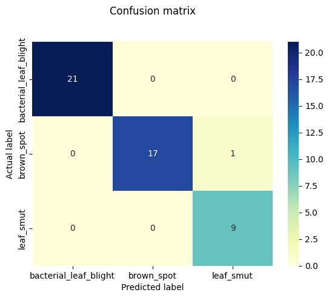 | 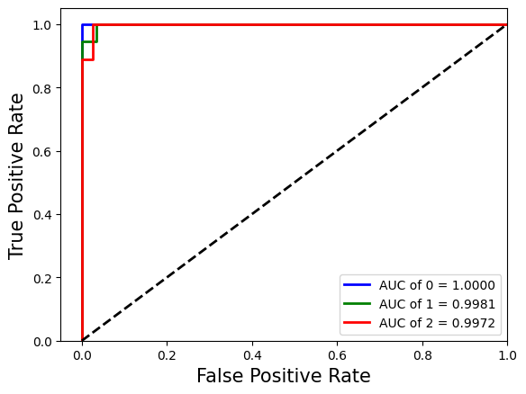 |
| 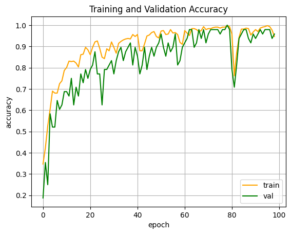 | 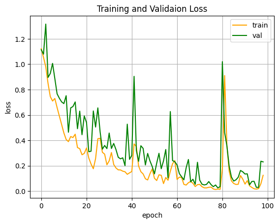 |

### Maize

| Confusion matrix | ROC curves |
|---|---|
| 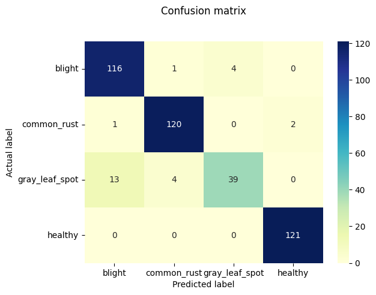 | 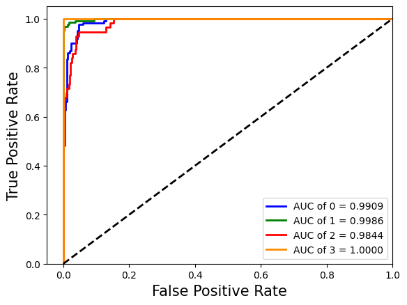 |
| 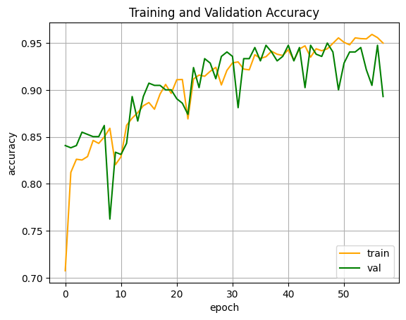 | 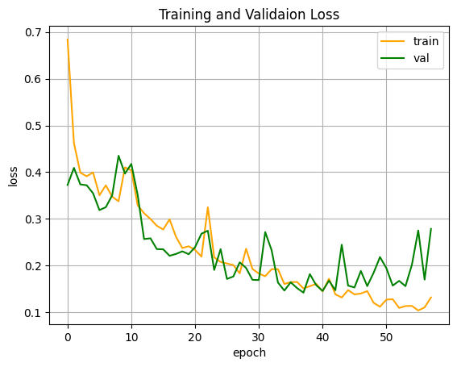 |

## Notes

- Parameter counts are 648,390, 648,132 and 648,261 for 5, 3 and 4 classes, matching the notebooks' `model.summary()`; the tests check them.
- The class folders are numbered `0`, `1`, `2`, ... in label order (see `data/README.md`).
- Maize is an additional experiment alongside Cassava and Rice.
- `--protocol holdout` trains with a validation set taken from the training data and uses the test set once.

## Repository structure

```
.
├── src/darinet/         # model, data loading, training and evaluation
├── scripts/             # train.py, evaluate.py
├── tests/               # unit tests (synthetic data; no dataset needed)
├── notebooks/           # original experiment notebooks (Cassava, Rice, Maize)
├── docs/figures/        # architecture and dataset figures
├── results/             # recorded notebook results and figures
└── data/README.md       # dataset instructions
```

Development: `pip install -e ".[dev]"`, then `ruff check .` and `pytest`.

## Citation

If you use this code, please cite the paper (a `CITATION.cff` is provided):

```bibtex
@inproceedings{chauhan2023darinet,
  author    = {Chauhan, Rashi and Karnati, Mohan and Dutta, Malay Kishore and Burget, Radim},
  title     = {Plant Disease Identification Using a Dual Self-Attention Modified Residual-Inception Network},
  booktitle = {2023 15th International Congress on Ultra Modern Telecommunications and Control Systems and Workshops (ICUMT)},
  publisher = {IEEE},
  year      = {2023},
  doi       = {10.1109/ICUMT61075.2023.10333302}
}
```

## License

MIT. See [LICENSE](LICENSE). The datasets have their own licenses; check them before reuse.

**Figures.** The architecture figure in `docs/figures/` is reproduced from the paper by its authors. Reuse of that figure is subject to the publisher's terms (IEEE). The sample leaf images come from the Cassava and Rice datasets; check their licenses. The MIT license covers the code and the result plots generated from the notebooks.
