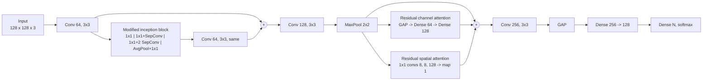

# DARINet

**Plant disease identification with a dual self-attention modified residual-inception network.**

[](https://github.com/RashiChauhan67/DARINet/actions/workflows/ci.yml)
[](LICENSE)


> **Paper.** R. Chauhan, M. Karnati, M. K. Dutta, R. Burget. *Plant Disease Identification Using a Dual Self-Attention Modified Residual-Inception Network.* 2023 15th International Congress on Ultra Modern Telecommunications and Control Systems and Workshops (**ICUMT**), IEEE, 2023. DOI: [10.1109/ICUMT61075.2023.10333302](https://doi.org/10.1109/ICUMT61075.2023.10333302)

[Overview](#overview) · [Architecture](#architecture) · [Quick start](#quick-start) · [Datasets](#datasets) · [Results](#results) · [Notes](#notes) · [Citation](#citation)

## Overview

DARINet is a compact CNN (about 0.65 M parameters) for classifying leaf images by disease. It combines a **modified inception block** (depthwise-separable convolutions), a residual connection, and two attention modules, **channel** and **spatial**, whose outputs are summed with the features. The network is identical across datasets; only the output layer changes.

This repository has a cleaned, tested Keras 3 implementation, the original experiment notebooks, and the recorded results.

| | Cassava | Rice | Maize |
|---|---|---|---|
| Classes | 5 | 3 | 4 |
| Test images | 590 | 48 | 421 |
| Test accuracy | **77%** | **97.9%** (see [Notes](#notes)) | **94%** |
| Macro F1 | 0.71 | 0.97 | 0.92 |
| Parameters | 648,390 | 648,132 | 648,261 |

Accuracies are the values recorded in the notebooks.

## Architecture


*Schematic of the network (Cassava, 5 classes). Layer widths in `src/darinet/model.py` are authoritative.*

The graph built by `src/darinet/model.py`:



## Quick start

```bash
git clone https://github.com/RashiChauhan67/DARINet.git
cd DARINet
python -m venv .venv && source .venv/bin/activate
pip install -e .
```

Train and evaluate:

```bash
# Original protocol: the test split also drives early stopping (see Notes)
python scripts/train.py --data-dir /path/to/cassava-disease/train --dataset cassava \
    --output-dir runs/cassava

# Leakage-free protocol: validation is taken from the training data, the test set is used once
python scripts/train.py --data-dir /path/to/rice_leaf_diseases --dataset rice \
    --protocol holdout --output-dir runs/rice_holdout

# Evaluate a saved model on the regenerated test split
python scripts/evaluate.py --data-dir /path/to/rice_leaf_diseases --dataset rice \
    --model runs/rice_holdout/best_model.keras
```

Defaults: Adam (Keras default 1e-3), batch size 16, up to 100 epochs, early stopping on validation loss (patience 10 for Cassava, 20 for Rice and Maize, best weights restored). Each run writes `best_model.keras`, `history.json` and `metrics.json`.

Use the model directly:

```python
from darinet.model import build_darinet, compile_model

model = compile_model(build_darinet(num_classes=5))  # 648,390 parameters
```

## Datasets

| Key | Dataset | Classes | Images | Test split |
|---|---|---|---|---|
| `cassava` | Cassava leaf disease | cbb, cbsd, cgm, cmd, healthy | 5,894 | 10% (590) |
| `rice` | Rice leaf diseases | bacterial leaf blight, brown spot, leaf smut | 120 originals | 10% (48) |
| `maize` | Maize leaf disease | blight, common rust, gray leaf spot, healthy | not recorded | 10% (421) |

Data is not included; see [`data/README.md`](data/README.md) for the expected folder layout (class folders `0`, `1`, ...), sources and citations. Images are resized to 128 x 128, scaled to [0, 1] and read with OpenCV.

## Results

Recorded in the original notebooks. **These were not re-run for this repository.** Per-class tables are in [`results/recorded_results.md`](results/recorded_results.md).

Cassava is the hardest dataset: the weakest class is `cbb` (precision 0.43, recall 0.51) and the strongest is `cmd` (recall 0.90). Maize's weakest class is gray leaf spot (recall 0.70).

### Cassava

| Confusion matrix | ROC curves |
|---|---|
|  |  |
|  |  |

Training accuracy keeps rising while validation accuracy flattens near 0.75 and validation loss turns upward, a sign of overfitting. Interpretability examples from the notebook:

| LIME | Grad-CAM |
|---|---|
|  |  |

### Rice

| Confusion matrix | ROC curves |
|---|---|
|  |  |
|  |  |

### Maize

| Confusion matrix | ROC curves |
|---|---|
|  |  |
|  |  |

## Notes

**Implementation.**
- The model matches the notebooks: parameter counts are 648,390, 648,132 and 648,261 for 5, 3 and 4 classes, as printed by `model.summary()`; the tests check them.
- The notebooks' FLOPs figure (about 9.3 GFLOPs for Cassava) comes from a hand-written per-layer estimator and is approximate.

**Rice result.** Treat it with caution.
- It rests on 48 test images, so one image changes accuracy by about 2 points.
- The Rice dataset has 120 original images, and the notebook's 48-image test split is 10% of 480 = 4 x 120. That suggests the folder already held augmented copies (flips and rotations) when it was split at random. If so, copies of the same leaf can fall on both sides of the split and the accuracy is inflated. This could not be checked from the notebook. If you rebuild this experiment, split the original images first and augment only the training portion.

**Evaluation.**
- The notebooks pass the test split as `validation_data`, and early stopping and checkpoint selection monitor its loss. Use `--protocol holdout` for numbers that are not selected on the test set.
- In the Cassava notebook the training cell is commented out: the model is loaded from a saved checkpoint, and the curves come from an earlier run. The Rice and Maize notebooks train in the notebook.
- Splits are random (not stratified) at the image level with a fixed seed. Near-duplicate images (several photos of one plant) can fall on both sides.
- No framework-level seeds are set, so a re-run will not reproduce the recorded numbers exactly. This port reads files in sorted order, so the exact test images can differ slightly.
- The notebooks expect class folders named `0`, `1`, `2`, ... in label order (see `data/README.md`). The Maize experiment is an extra one, included alongside Cassava and Rice.

## Repository structure

```
.
├── src/darinet/         # model, data loading, training and evaluation
├── scripts/             # train.py, evaluate.py
├── tests/               # unit tests (synthetic data; no dataset needed)
├── notebooks/           # original experiment notebooks (Cassava, Rice, Maize)
├── docs/figures/        # architecture figure
├── results/             # recorded notebook results and figures
└── data/README.md       # dataset instructions
```

Development: `pip install -e ".[dev]"`, then `ruff check .` and `pytest`.

## Citation

If you use this code, please cite the paper (a `CITATION.cff` is provided):

```bibtex
@inproceedings{chauhan2023darinet,
  author    = {Chauhan, Rashi and Karnati, Mohan and Dutta, Malay Kishore and Burget, Radim},
  title     = {Plant Disease Identification Using a Dual Self-Attention Modified Residual-Inception Network},
  booktitle = {2023 15th International Congress on Ultra Modern Telecommunications and Control Systems and Workshops (ICUMT)},
  publisher = {IEEE},
  year      = {2023},
  doi       = {10.1109/ICUMT61075.2023.10333302}
}
```

## License

MIT. See [LICENSE](LICENSE). The datasets have their own licenses; check them before reuse.

**Figures.** The architecture figure in `docs/figures/` is reproduced from the paper by its authors. Reuse of that figure is subject to the publisher's terms (IEEE); the MIT license covers the code and the result plots generated from the notebooks.
