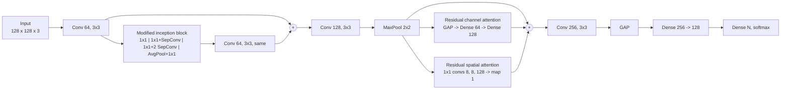

# DARINet: Plant Disease Identification with a Dual Self-Attention Modified Residual-Inception Network

[](https://github.com/RashiChauhan67/DARINet/actions/workflows/ci.yml)
[](LICENSE)


> **Paper.** R. Chauhan, M. Karnati, M. K. Dutta, R. Burget. *Plant Disease Identification Using a Dual Self-Attention Modified Residual-Inception Network.* 2023 15th International Congress on Ultra Modern Telecommunications and Control Systems and Workshops (**ICUMT**), IEEE, 2023. DOI: [10.1109/ICUMT61075.2023.10333302](https://doi.org/10.1109/ICUMT61075.2023.10333302)

DARINet is a compact CNN (about 0.65 M parameters) for classifying leaf images by disease. It combines a **modified inception block** with depthwise-separable convolutions, a residual connection, and two attention modules (**channel** and **spatial**) whose outputs are summed with the features.

The code was cleaned up from the original Colab notebooks (kept unmodified in [`notebooks/`](notebooks/)). The network is identical across datasets; only the number of output classes changes. Please read [Relationship between this code and the paper](#relationship-between-this-code-and-the-paper) before comparing numbers.

## Highlights

- Three datasets: **Cassava** (5 classes), **Rice** (3 classes) and an extra **Maize** experiment (4 classes) that is not in the paper.
- Recorded test accuracy in the notebooks: Cassava **77%** (590 test images, the paper reports 77.12%), Rice **97.92%** (only 48 test images; the paper reports 98.92%), Maize **94%** (421 test images).
- 648,390 parameters for 5 classes; about 9.3 GFLOPs by the notebooks' estimator (the paper reports 0.63 M and 9).
- Modular Keras 3 port with unit tests, a command-line trainer, and two training protocols (`notebook` and a leakage-free `holdout`).

## Architecture

The author's figure from the paper (Cassava, 5 classes):


What the code in `src/darinet/model.py` builds (this matches the notebooks, verified by parameter count for all three class counts):



## Relationship between this code and the paper

| Item | Paper | Notebooks (and this code) |
|---|---|---|
| Datasets | Cassava and Rice | Cassava, Rice, **and Maize** (extra, not in the paper) |
| Cassava accuracy | 77.12% (precision 74%, recall 70%, F1 71%) | 0.77; macro precision 0.74, recall 0.70, F1 0.71 |
| Rice accuracy | 98.92% | 0.9792 on **48** test images (one image is 2.1 points) |
| Parameters | 0.63 M | 648,390 for 5 classes (0.648 M) |
| GFLOPs / GMACs | 9 / 4 | 9.30 GFLOPs by the notebook's estimator |
| Split, batch size, epochs, optimizer | 90:10, 16, up to 100 with early stopping, Adam 1e-3 | the same (Keras default Adam learning rate is 1e-3) |
| Channel attention | GAP, Dense 64, Dense 64, sigmoid (figure) | GAP, Dense 64, Dense **128**, sigmoid (C = 128) |
| Spatial attention | 3x3 convs of 8, 8, 64, then 1x1 (figure) | **1x1** convs of 8, 8, **128**, then 1x1 |

Two things to know about how the recorded numbers were produced:

- In the Cassava notebook the training cell is **commented out**. The model is loaded from a saved checkpoint (`best_Plant_weights.h5`) and the training curves are the output of an earlier run of that cell. The Rice and Maize notebooks train in the notebook.
- Early stopping and checkpointing monitor `val_loss` on the test split (see Limitations).

## Datasets

| Key | Dataset | Classes | Test split |
|---|---|---|---|
| `cassava` | Cassava leaf disease | 5: cbb, cbsd, cgm, cmd, healthy | 10% (590 images) |
| `rice` | Rice leaf diseases | 3: bacterial leaf blight, brown spot, leaf smut | 10% (48 images) |
| `maize` | Maize leaf disease | 4: blight, common rust, gray leaf spot, healthy | 10% (421 images) |

Datasets are not included. See [`data/README.md`](data/README.md) for the expected folder layout (class folders `0`, `1`, ...), sources and citations. Images are resized to 128 x 128, scaled to [0, 1] and read with OpenCV.

## Installation

```bash
git clone https://github.com/RashiChauhan67/DARINet.git
cd DARINet
python -m venv .venv && source .venv/bin/activate
pip install -e .
```

## Usage

```bash
# Original protocol (the test split also drives early stopping; see below)
python scripts/train.py --data-dir /path/to/cassava-disease/train --dataset cassava \
    --output-dir runs/cassava

# Leakage-free protocol: validation is taken from the training data, the test set is used once
python scripts/train.py --data-dir /path/to/rice_leaf_diseases --dataset rice \
    --protocol holdout --output-dir runs/rice_holdout

# Evaluate a saved model on the regenerated test split
python scripts/evaluate.py --data-dir /path/to/rice_leaf_diseases --dataset rice \
    --model runs/rice_holdout/best_model.keras
```

Defaults follow the notebooks: Adam (Keras default 1e-3), batch size 16, up to 100 epochs, early stopping on validation loss (patience 10 for Cassava, 20 for Rice and Maize, best weights restored). Each run writes `best_model.keras`, `history.json` and `metrics.json`.

```python
from darinet.model import build_darinet, compile_model

model = compile_model(build_darinet(num_classes=5))  # 648,390 parameters
```

## Recorded results (from the original notebooks)

These are the numbers stored in the notebooks' outputs. **They were not re-run for this repository.**

| Dataset | Test images | Accuracy | Macro F1 | Paper reports |
|---|---|---|---|---|
| Cassava | 590 | **0.77** | 0.71 | 77.12% |
| Rice | 48 | **0.9792** (loss 0.0358) | 0.97 | 98.92% |
| Maize | 421 | **0.94** | 0.92 | not in the paper |

Per-class tables are in [`results/recorded_results.md`](results/recorded_results.md). Cassava is the hardest dataset: the weakest class is `cbb` (precision 0.43, recall 0.51) and the strongest is `cmd` (recall 0.90). Maize's weakest class is gray leaf spot (recall 0.70).

### Cassava

| Confusion matrix | ROC curves |
|---|---|
|  |  |
|  |  |

The training curves show clear overfitting: training accuracy keeps rising while validation accuracy flattens near 0.75 and validation loss turns upward. Interpretability examples from the notebook (LIME explanation and a Grad-CAM heatmap):

| LIME | Grad-CAM |
|---|---|
|  |  |

### Rice (48 test images)

| Confusion matrix | ROC curves |
|---|---|
|  |  |
|  |  |

### Maize (extra experiment)

| Confusion matrix | ROC curves |
|---|---|
|  |  |
|  |  |

## Limitations and reproducibility notes

- **The recorded test accuracy is optimistic.** The notebooks pass the test split as `validation_data`, and early stopping and checkpoint selection monitor its loss. Use `--protocol holdout` for numbers that are not selected on the test set.
- **The Rice result rests on 48 test images**, so it carries a large uncertainty: one image changes accuracy by about 2 points, and the gap to the paper's 98.92% is a single image.
- Splits are random (not stratified), at the image level, with a fixed seed. Near-duplicate images (several photos of one plant) can fall on both sides.
- No framework-level random seeds are set in the notebooks, so a re-run will not reproduce the recorded numbers bit for bit. This port reads files in sorted order, so the exact test images can differ slightly from the original runs.
- The notebooks' FLOPs figure comes from a hand-written per-layer estimator and is approximate. Parameter counts are exact.
- The notebooks expect class folders named `0`, `1`, `2`, ... in label order; see `data/README.md`.

## Repository layout

```
.
├── src/darinet/         # model, data loading, training and evaluation
├── scripts/             # train.py, evaluate.py
├── tests/               # unit tests (synthetic data; no dataset needed)
├── notebooks/           # original notebooks for Cassava, Rice and Maize (unmodified)
├── docs/figures/        # architecture figure from the paper
├── results/             # recorded notebook results and figures
└── data/README.md       # dataset instructions
```

## Development

```bash
pip install -e ".[dev]"
ruff check .
pytest
```

The tests check, among other things, that the model has exactly the parameter counts printed by the notebooks (648,390 / 648,132 / 648,261 for 5 / 3 / 4 classes).

## Citation

If you use this code, please cite the paper (a `CITATION.cff` is provided):

```bibtex
@inproceedings{chauhan2023darinet,
  author    = {Chauhan, Rashi and Karnati, Mohan and Dutta, Malay Kishore and Burget, Radim},
  title     = {Plant Disease Identification Using a Dual Self-Attention Modified Residual-Inception Network},
  booktitle = {2023 15th International Congress on Ultra Modern Telecommunications and Control Systems and Workshops (ICUMT)},
  publisher = {IEEE},
  year      = {2023},
  doi       = {10.1109/ICUMT61075.2023.10333302}
}
```

## License

MIT. See [LICENSE](LICENSE). The datasets have their own licenses; check them before reuse.

**Figures.** The architecture figure in `docs/figures/` is reproduced from the paper by its authors. Reuse of that figure is subject to the publisher's terms (IEEE); the MIT license covers the code, and the result plots generated from the notebooks.
